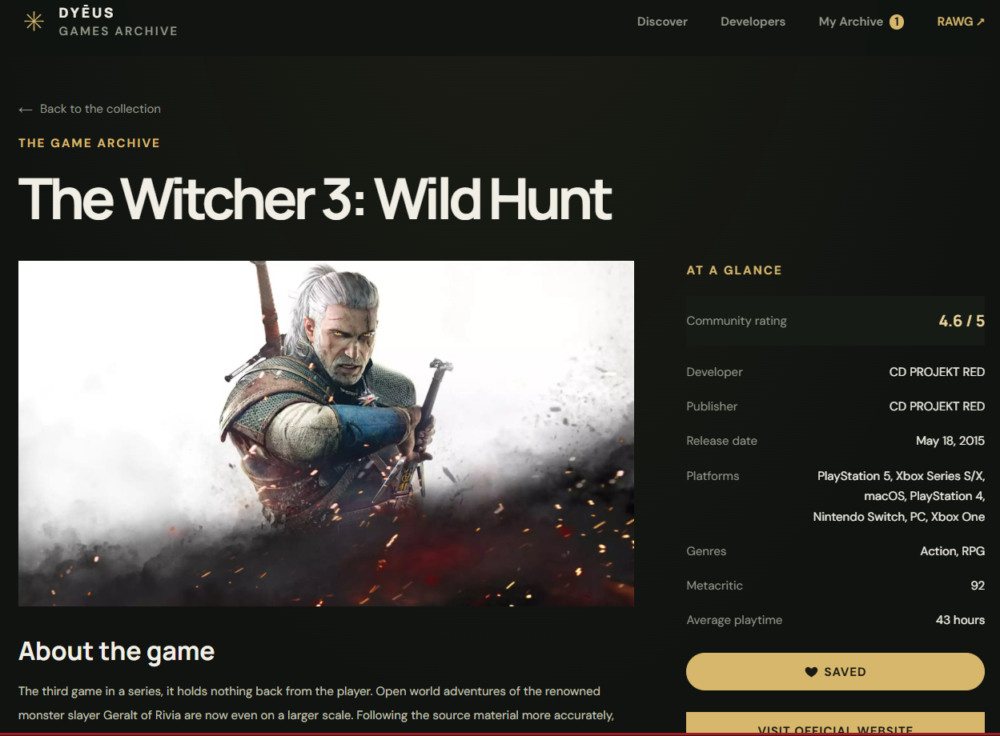
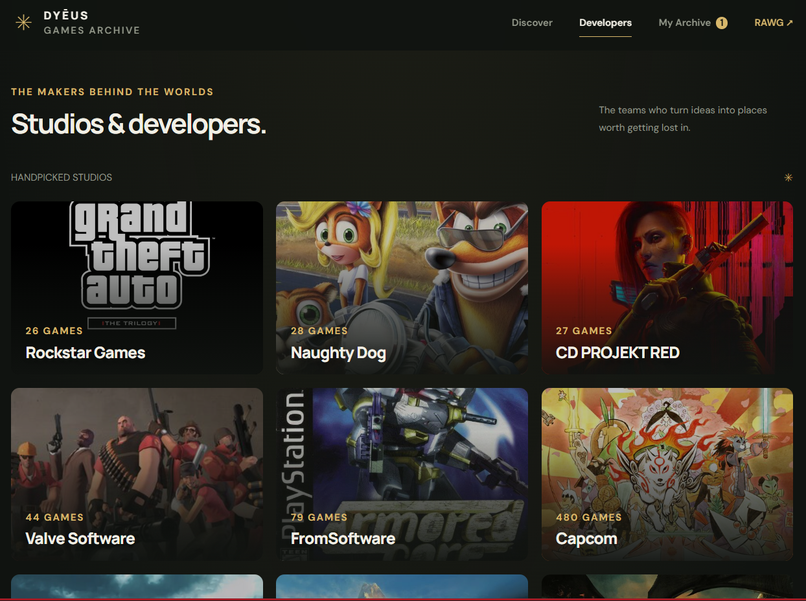
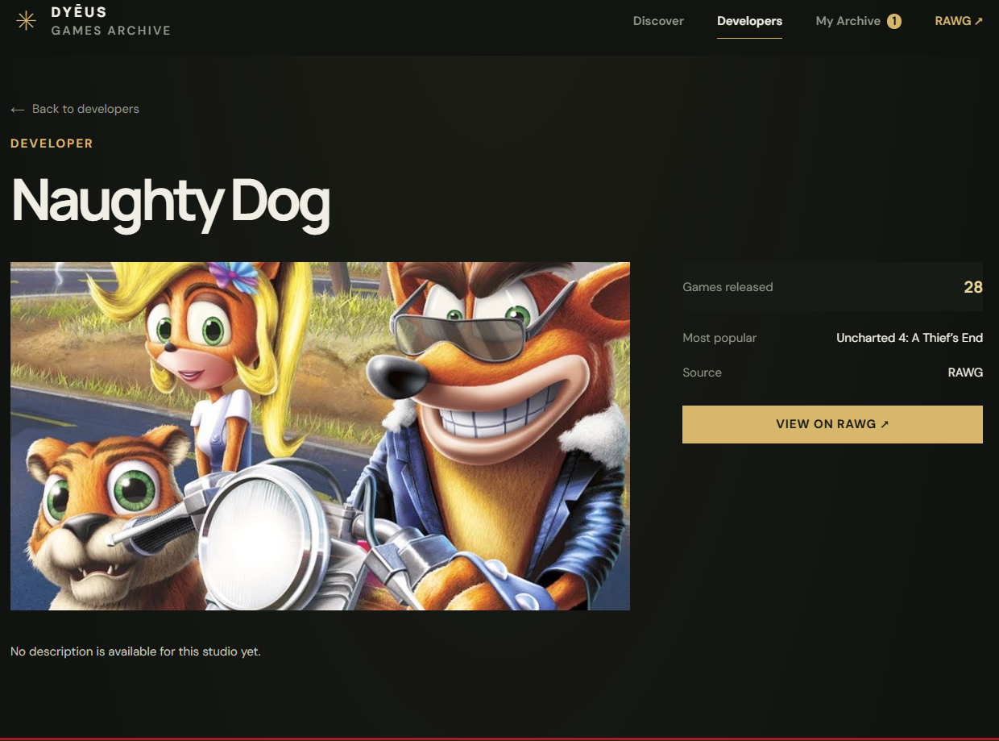
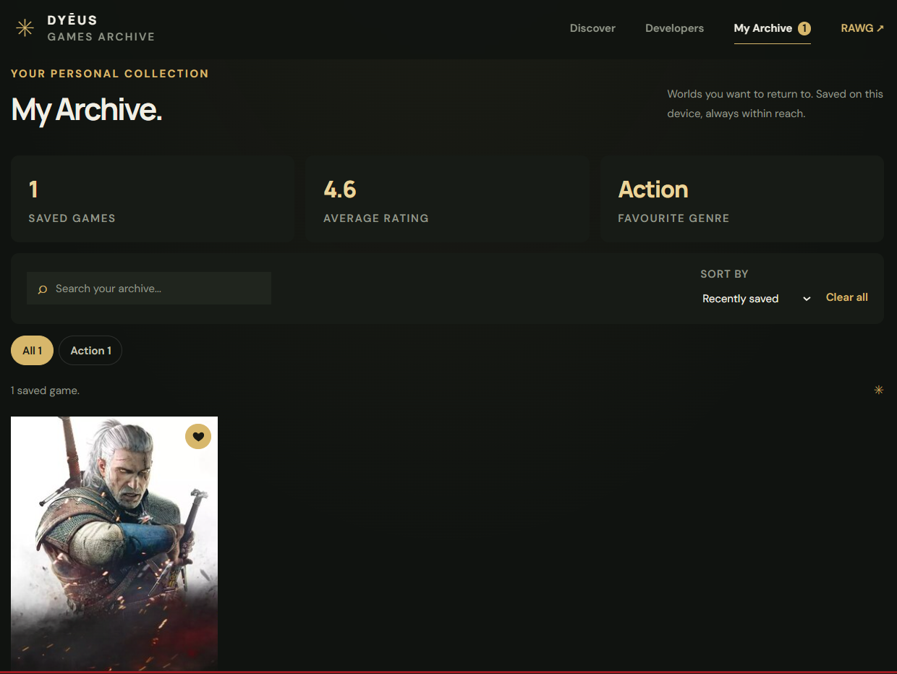

# Dyēus Games

Адаптивний та доступний вебзастосунок-каталог відеоігор. Дані беруться з публічного REST API [RAWG](https://rawg.io/apidocs). Проєкт виконано як індивідуальне завдання з дисципліни «Сучасна веброзробка: HTML, CSS, JS/TS» (НУОА, кафедра ІТАД).

- **Опублікований застосунок:** https://dy-us-game-store.vercel.app/index.html
- **Репозиторій:** https://github.com/Keaydwd/Dy-us-GameStore

## Призначення

Застосунок допомагає знайти гру, переглянути її деталі, дізнатися про студії-розробників і зібрати власну колекцію «My Archive». Власного backend немає: дані приходять напряму з RAWG, а колекція зберігається в браузері користувача.

## Основна функціональність

| Сторінка | Що робить |
|---|---|
| `index.html` | Карусель популярних ігор з автопрогортанням і кнопкою паузи. Каталог із пошуком, фільтром за жанром, сортуванням і безкінечним скролом |
| `details.html` | Деталі гри: опис, рейтинг, розробники, видавці, платформи, жанри, Metacritic, середній час проходження, кнопка збереження |
| `developers.html` | Добірка відомих студій і повний каталог розробників із кнопкою «Load more studios» |
| `developer.html` | Профіль студії, кількість ігор і перелік її найпопулярніших проєктів |
| `favorites.html` | «My Archive»: збережені ігри, пошук, сортування, чипи жанрів, статистика (кількість, середній рейтинг, улюблений жанр) |

### Інтерактивні сценарії

1. **Карусель:** стрілки, мініатюри з індикатором прогресу, пауза, керування клавішами ← →, свайп на дотикових екранах.
2. **Каталог:** пошук із debounce, фільтр за жанром, сортування, скидання, безкінечний скрол через `IntersectionObserver`.
3. **My Archive:** кнопка Save на кожній картці, лічильник у шапці, скасування дії (Undo) у сповіщенні, синхронізація між вкладками браузера, фільтрація й сортування колекції.
4. **Каталог студій:** посторінкове завантаження.

## Технології

- HTML5 (семантична розмітка), CSS3 (змінні, Grid, Flexbox, media queries, анімації)
- TypeScript (`strict`), модульна структура
- Vite (мультисторінкова збірка), npm
- Vitest + jsdom для тестів
- ESLint (typescript-eslint) і Prettier
- Fetch API, `async/await`, `AbortController`
- Хостинг: Vercel

## API

Використовується [RAWG Video Games Database API](https://api.rawg.io/docs/).

| Ендпоінт | Призначення |
|---|---|
| `GET /games` | Каталог, карусель, ігри студії |
| `GET /games/{id}` | Деталі гри |
| `GET /developers` | Каталог студій |
| `GET /developers/{id або slug}` | Профіль студії |

Для роботи потрібен безкоштовний ключ: https://rawg.io/apidocs

## Запуск

```bash
git clone https://github.com/Keaydwd/Dy-us-GameStore.git
cd game-store
npm install
```

Створіть файл `.env` у корені проєкту за зразком `.env.example`:

```
VITE_RAWG_API_KEY=ваш_ключ
```

| Команда | Дія |
|---|---|
| `npm run dev` | Режим розробки |
| `npm run build` | Перевірка типів і збірка в `dist/` |
| `npm run preview` | Перегляд зібраної версії |
| `npm test` | Запуск тестів |
| `npm run typecheck` | Перевірка типів TypeScript |
| `npm run lint` | ESLint |
| `npm run format` | Prettier |

Vite підставляє змінні середовища під час збірки, тому після зміни `.env` потрібно перезапустити `npm run dev`.

## Деплой

Застосунок опублікований на Vercel. Vercel розпізнає Vite автоматично (команда `npm run build`, папка `dist`). Ключ API задається у змінній середовища `VITE_RAWG_API_KEY` в налаштуваннях проєкту. Кожен `git push` у гілку `main` запускає новий деплой.

## Структура проєкту

```
├── index.html, details.html, developers.html,
│   developer.html, favorites.html     # сторінки MPA
├── public/                            # favicon.svg, robots.txt
├── src/
│   ├── shared.ts                      # типи, клієнт API, картка гри, кнопка Save
│   ├── wishlist.ts                    # сховище колекції (localStorage + підписки)
│   ├── toast.ts                       # сповіщення з кнопкою дії
│   ├── featured.ts                    # карусель
│   ├── main.ts                        # каталог
│   ├── details.ts                     # сторінка гри
│   ├── developers.ts, developer.ts    # студії
│   ├── favorites.ts                   # My Archive
│   ├── style.css                      # стилі
│   ├── test-setup.ts                  # localStorage у пам'яті для тестів
│   └── *.test.ts                      # тести
├── vite.config.ts                     # мультисторінкова збірка і Vitest
└── eslint.config.js, .prettierrc
```

## Технічний звіт

### Архітектура

Застосунок складається з п'яти HTML-сторінок і окремого TypeScript-модуля для кожної. Спільна логіка винесена в `shared.ts`, щоб не дублювати код. Усі запити до RAWG проходять через одну функцію `api<T>()`, яка додає ключ, формує URL, приймає `AbortSignal` і кидає типізовану `ApiError` зі статусом відповіді. Завдяки цьому кожна сторінка може по-різному реагувати на помилки, наприклад, окремо на 404.

### Стан колекції

Модуль `wishlist.ts` є єдиним джерелом правди для збережених ігор. Він тримає дані в пам'яті, записує їх у `localStorage` і повідомляє підписників про зміни. Інтерфейс не звертається до `localStorage` напряму, тому кнопки Save, лічильник у шапці та сторінка колекції завжди узгоджені. Подія `storage` синхронізує кілька відкритих вкладок. Дані зі сховища проходять валідацію (`isSavedGame`), а читання й запис обгорнуті в `try/catch`, тому пошкоджений або заблокований `localStorage` не ламає застосунок.

У колекції зберігається легкий знімок гри (назва, зображення, рейтинг, жанр, дата), тому сторінка My Archive відкривається миттєво й не робить запитів до API.

### Loading та error states

- Індикатор завантаження для каталогу, сторінки гри, студій і скелетон для каруселі.
- Окремі повідомлення про помилку: мережа, 404, некоректний `id` в адресі, відсутній ключ API.
- Порожні стани: «No games found», «No matches», «Your archive is empty».
- Помилка підвантаження наступної сторінки не стирає вже завантажені картки.

### Асинхронність

Пошук використовує debounce (350 мс) і `AbortController`: новий запит скасовує попередній, а перевірка `controller !== listController` захищає від гонки відповідей, коли застаріла відповідь приходить пізніше за нову. Сторінка студії завантажує профіль і список ігор паралельно через `Promise.all`, а добірка топ-студій використовує `Promise.allSettled`, тому недоступна студія не ламає всю сторінку.

### Безпека

Дані з API вставляються через `textContent`, а не `innerHTML`. Опис студії, який RAWG повертає як HTML, перетворюється на текст через `DOMParser` (скрипти не виконуються, елементи `script` і `style` видаляються). Зовнішні посилання перевіряються на протокол (`http` або `https`) і відкриваються з `rel="noopener noreferrer"`. `innerHTML` використовується лише для статичної SVG-іконки без даних API.

Ключ RAWG із префіксом `VITE_` потрапляє у клієнтський код. Це усвідомлене рішення: завдання не передбачає власного backend, а ключ безкоштовний і призначений для використання у браузері. Файл `.env` не потрапляє в репозиторій (`.gitignore`), у репозиторії є лише `.env.example`.

### Продуктивність

- Зменшені копії зображень через `media/resize` RAWG з поверненням до оригіналу при помилці.
- `loading="lazy"` та `decoding="async"` для зображень поза першим екраном.
- `preconnect` до `api.rawg.io`, `media.rawg.io` і Google Fonts.
- Прогрес-бар каруселі реалізований через CSS-анімацію без `setInterval`.

### Доступність (WCAG 2.2)

- Семантична структура: `header`, `nav`, `main`, `section`, `footer`, послідовні рівні заголовків, на кожній сторінці один `h1`.
- Посилання «Skip to content» і видимий фокус `:focus-visible`.
- Кнопка паузи каруселі (критерій 2.2.2), вимкнене автопрогортання при `prefers-reduced-motion`.
- Мінімальний розмір інтерактивних елементів 24×24 px (критерій 2.5.8), зокрема сегменти каруселі на мобільному.
- `aria-pressed` і динамічний `aria-label` на кнопці Save, `role="status"` для сповіщень і станів завантаження.
- Кнопка Save не вкладена в посилання картки.
- Керування каруселлю з клавіатури.

### Адаптивність

Макет перевірено на ширинах від 320 px. Каталог перебудовується з 4 колонок на 3, потім на 2. Карусель на вузьких екранах замінює список мініатюр на сегментний індикатор. Сповіщення на телефоні займає всю ширину з відступами, а довга назва гри переноситься максимум на два рядки.

### Тестування

Тести написані у Vitest із середовищем jsdom (`npm test`, 28 тестів у 4 файлах).

| Файл | Що перевіряється |
|---|---|
| `wishlist.test.ts` | додавання, видалення, очищення, відновлення (Undo), збереження, пошкоджений JSON, невалідні записи, підписки, синхронізація між вкладками |
| `shared.test.ts` | форматування чисел, `htmlToText` (очищення від скриптів), `setSizedImage`, `toSavedGame`, картка гри, кнопка Save |
| `api.test.ts` | формування URL, `ApiError` зі статусом, відсутній ключ (`fetch` замінений моком) |
| `toast.test.ts` | показ, одне сповіщення за раз, кнопка дії, автоприховування |

Нові версії Node мають вбудований `localStorage`, який перекриває реалізацію jsdom і не має методів. Тому в `test-setup.ts` підставляється власне сховище в пам'яті, і тести не залежать від версії Node.

Під час написання тестів знайдено й виправлено дві помилки: `htmlToText` залишав текст зі `<script>`, а `setSizedImage` не позначав зображення недоступним, якщо не завантажувалось і оригінальне.

### Debugging

Під час розробки використовувалися точки зупину в DevTools (наприклад, у `fetchGames`), вкладка Network для перевірки запитів і статусів RAWG, емуляція Offline для перевірки error states, а також `console.error` для діагностики помилок API. Справжні проблеми, знайдені таким чином: переповнення сповіщення за межі екрана на телефоні (відсутній `min-width: 0` у flex-контейнері) і падіння тестів на новій версії Node через вбудований `localStorage`.

### Обмеження

- Безкоштовний ключ RAWG має ліміт запитів.
- Колекція зберігається лише на поточному пристрої та в поточному браузері.
- Добірка студій на сторінці Developers задана списком slug-ів. Студії, яких RAWG не знаходить, не показуються.

## Скріншоти

[Головна](https://github.com/Keaydwd/Dy-us-GameStore/blob/main/docs/archive.png)]

```

```
```

```
```

```
```

```
## SEO

Унікальні `title` і `meta description` на кожній сторінці (на сторінках гри й студії вони оновлюються динамічно), теги Open Graph, favicon, `robots.txt`.

## Дані

Дані про ігри надає [RAWG](https://rawg.io/). Відповідно до умов використання API, на сайті розміщено посилання на RAWG.
